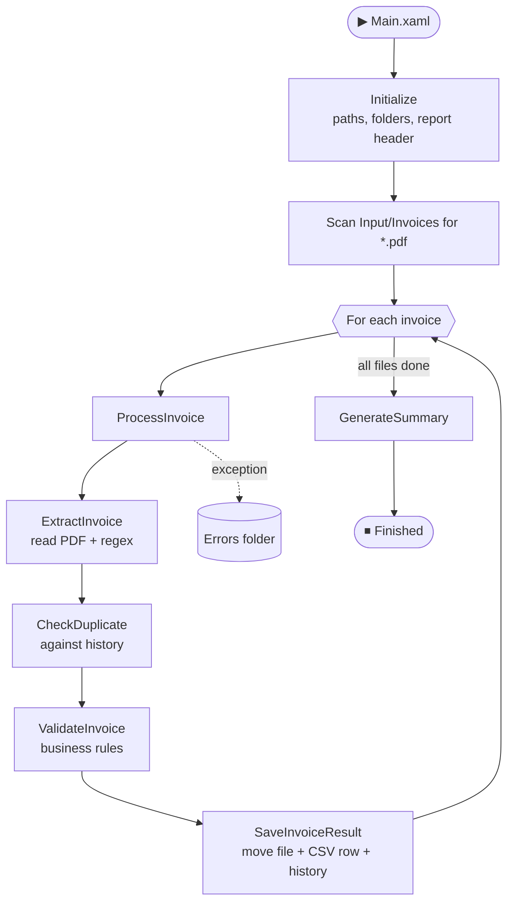

<div align="center">

# 🧾 InvoiceFlow

### Automated invoice processing with UiPath: extract, validate, route, report.

[](https://www.uipath.com/)
[](#-tech-stack)
[](#-tech-stack)
[](#-roadmap)

<br/>

**InvoiceFlow** reads PDF invoices from a folder, pulls out the key fields, checks each one against business rules and a duplicate history, then sorts the files into *Accepted*, *Rejected* or *Errors* and produces a clean CSV report with a batch summary.

[Features](#-features) •
[How it works](#-how-it-works) •
[Project structure](#-project-structure) •
[Getting started](#-getting-started) •
[Output](#-output) •
[Roadmap](#-roadmap)

</div>

---

## ✨ Features

| | Feature | Description |
|---|---|---|
| 📄 | **PDF data extraction** | Reads invoice text and extracts 12 fields with regular expressions: number, supplier, customer, dates, currency, subtotal, VAT, VAT rate and total. |
| 🔁 | **Duplicate detection** | Compares the invoice number found *inside* the PDF (case-insensitive) with a history file, so renamed files can't slip through. |
| ✅ | **Rule-based validation** | Checks for missing fields, invalid or future dates and invalid totals, and collects **every** problem into one readable reason. |
| 🗂️ | **Automatic routing** | Moves each PDF to `Accepted`, `Rejected` or `Errors` depending on the result. |
| 📊 | **CSV reporting** | Appends one fully quoted, 13-column row per invoice to a report ready for Excel or BI tools. |
| 🛡️ | **Fault isolation** | A Try/Catch around each invoice means one corrupt file never stops the batch. |
| 🧮 | **Batch summary** | Logs processed, accepted, rejected and error counts, plus the accepted total, at the end of every run. |

---

## ⚙️ How it works



### Workflows

| Workflow | Responsibility |
|---|---|
| `Main.xaml` | Entry point. Calls Initialize, loops over the PDFs, isolates failures with Try/Catch and calls GenerateSummary. |
| `Initialize.xaml` | Builds all paths, creates missing folders, writes the CSV header and creates the history file. |
| `ProcessInvoice.xaml` | Orchestrates the processing of a single invoice. Contains no business logic of its own. |
| `ExtractInvoice.xaml` | Reads the PDF text and extracts the invoice fields with regular expressions. |
| `CheckDuplicate.xaml` | Returns `True` if the invoice number already exists in `processed_invoices.txt`. |
| `ValidateInvoice.xaml` | Applies the validation rules and returns `IsValid` plus a combined `Reason`. |
| `SaveInvoiceResult.xaml` | Moves the PDF, appends the CSV row and records accepted invoice numbers in the history. |
| `GenerateSummary.xaml` | Reads the CSV and logs the final batch statistics. |

Each workflow does **one job** and communicates only through typed arguments, which keeps every piece testable on its own.

---

## 🧪 Validation rules

An invoice is **Accepted** only if it passes all of these. Otherwise it is **Rejected**, and the reason column lists every failed rule.

| Rule | Reason written to the report |
|---|---|
| Invoice number already in history | `Duplicate invoice` |
| Invoice number is empty | `Missing invoice number` |
| Supplier is empty | `Missing vendor` |
| Date is missing or not a valid `dd/MM/yyyy` | `Invalid or missing date` |
| Invoice date is in the future | `Invoice date in the future` |
| Total is missing, non-numeric or ≤ 0 | `Invalid or missing total` |

> Only **accepted** invoice numbers are written to the history file, so a rejected invoice never blocks its corrected version from being accepted later.

---

## 📁 Project structure

```text
InvoiceFlow/
│
├── Main.xaml                    # Entry point
│
├── Workflows/
│   ├── Initialize.xaml
│   ├── ProcessInvoice.xaml
│   ├── ExtractInvoice.xaml
│   ├── CheckDuplicate.xaml
│   ├── ValidateInvoice.xaml
│   ├── SaveInvoiceResult.xaml
│   └── GenerateSummary.xaml
│
├── Config/
│   └── Config.xlsx              # Reserved for externalised settings (see roadmap)
│
├── Data/
│   ├── Input/
│   │   └── Invoices/            # Drop PDF invoices here
│   └── Output/
│       ├── Accepted/            # Valid invoices
│       ├── Rejected/            # Invalid or duplicate invoices
│       ├── Errors/              # Files that crashed processing
│       ├── invoice_report.csv   # Full report
│       └── processed_invoices.txt   # Duplicate-check history
│
├── Logs/
├── project.json
└── project.uiproj
```

---

## 🧰 Tech stack

- **[UiPath Studio](https://www.uipath.com/product/studio)**: cross-platform project, **C#** expressions
- **UiPath.PDF.Activities**: PDF text reading
- **UiPath.System.Activities**: file, folder and flow-control activities
- **.NET regular expressions**: field extraction (`System.Text.RegularExpressions`)
- **LINQ**: duplicate lookups and summary calculations

---

## 🚀 Getting started

### Prerequisites

- UiPath Studio (a cross-platform project, running on Windows, macOS or Linux)
- The dependencies listed in `project.json` (Studio restores them automatically)

### Run it

1. **Clone** the repository
   ```bash
   git clone https://github.com/<your-username>/InvoiceFlow.git
   ```
2. **Open** `project.json` in UiPath Studio.
3. **Add invoices:** place your PDF files in `Data/Input/Invoices/`. This folder is git-ignored, so you supply your own files.
4. **Run** `Main.xaml` (Debug or Run).
5. **Check the results** in `Data/Output/`.

> The output folders, the CSV header and the history file are created automatically by `Initialize.xaml` on the first run.

### Expected invoice layout

The extractor looks for labelled lines in the PDF text:

```text
INVOICE
INV-2026-001
Supplier: Nile Technology Solutions
Invoice Date: 05/11/2026
Due Date: 20/11/2026
Customer: ABC Enterprises
Payment terms: 15 days. Currency: EGP.
Description Amount
Software Services 10,000.00
VAT (14%) 1,400.00
Total 11,400.00
```

Dates use the `dd/MM/yyyy` format. Other layouts need the patterns in `ExtractInvoice.xaml` adjusted.

---

## 📊 Output

### CSV report: `invoice_report.csv`

One row per invoice, all values quoted so amounts like `11,400.00` stay in a single column.

| Column | Example |
|---|---|
| InvoiceNumber | `INV-2026-001` |
| Supplier | `Nile Technology Solutions` |
| Customer | `ABC Enterprises` |
| InvoiceDate | `05/11/2026` |
| DueDate | `20/11/2026` |
| Currency | `EGP` |
| Subtotal | `10,000.00` |
| VAT | `1,400.00` |
| VATRate | `14` |
| Total | `11,400.00` |
| Status | `Accepted` / `Rejected` |
| ValidationMessage | `Duplicate invoice` (empty when accepted) |
| FilePath | Final location of the PDF |

### Batch summary

Logged at the end of every run:

```text
SUMMARY | Processed: 12 | Accepted: 11 | Rejected: 1 | Errors: 0 | Accepted total: 245,529.00 EGP
```

---

## 🛡️ Error handling

- **Per-invoice isolation:** every file is processed inside its own Try/Catch. On an unexpected exception the error is logged, the file is moved to `Errors/`, and the run continues with the next invoice.
- **Idempotent setup:** `Initialize` only creates what is missing, so repeated runs are safe.
- **Case-insensitive matching:** `INv-2026-107.pdf` and `INV-2026-107` are treated consistently.

---

## 🗺️ Roadmap

- [x] End-to-end pipeline: extract, check duplicates, validate, save, summarise
- [x] CSV reporting with a 13-column schema
- [x] Per-invoice error isolation
- [ ] Read folder paths and settings from `Config/Config.xlsx`
- [ ] Optional rule: flag VAT rates that differ from the standard 14%
- [ ] Unit tests for extraction and validation (UiPath.Testing)
- [ ] Orchestrator deployment with a queue-based dispatcher/performer split
- [ ] Email notification with the batch summary

---

## 🔒 Notes

- `Data/Output/`, `Data/Input/Invoices/` and `Logs/` are excluded via `.gitignore`, because they contain generated data and local file paths.
- Never store credentials in `Config.xlsx`. Use Orchestrator assets or environment variables.

---

<div align="center">

**Built with UiPath**

If you find this project useful, consider giving it a ⭐

</div>
